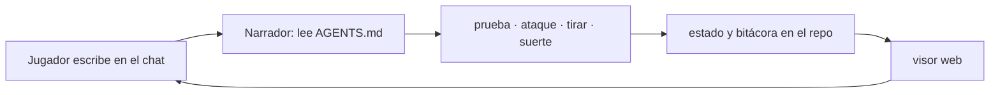

# Mesa de rol

Una mesa de rol por chat en la que una IA dirige la historia y los dados que salen son los que se tiran.

## Estado

Alpha en marcha. Funciona hoy: un motor de reglas d20 con estado persistente, un visor web para
tener al lado del chat, una memoria de la historia que no crece con la conversación y lecciones que
pasan de una partida a la siguiente.

- **Partida de demo:** [`partidas/los-hermanos-del-neva/`](partidas/los-hermanos-del-neva/) es la
  partida de ejemplo que viaja en el repo. Dos hermanos pescadores en Petrogrado, otoño de 1917, con
  su biblia, su bitácora, su escena a medias y sus notas del director. Está guardada en pausa a
  mitad de escena y se abre tal como quedó.
- **Dos esquemas de reglas:** `d20-simple` (cuatro atributos-bono) para la demo y las partidas
  anteriores; `dnd-2024` (seis características con puntuación) para las nuevas. El motor de 2024
  todavía no tira: ver [Límites](#límites).
- **Sin CI ni publicaciones:** no hay workflow, ni tags, ni instalación en un registro de paquetes.
  Las pruebas se corren a mano.

## Cómo correrlo

Tres comandos, probados en un clon limpio. No hay que instalar nada: Python 3.10 o superior, sin
dependencias.

```bash
git clone https://github.com/Grizaceo/mesa-de-rol.git && cd mesa-de-rol
bin/mesa harness sync    # deja tu harness listo (Claude Code, Codex, OpenCode, Gemini CLI, Cursor)
bin/mesa servir          # el visor, en http://127.0.0.1:8765
```

El visor abre con la partida de demo: la escena, las fichas de los dos hermanos, los PNJ y las
pistas que han salido, la bitácora de tiradas y la imagen de la escena. El mapa de la zona, los
documentos y la memoria son de las partidas nuevas: la demo es anterior a esas tres cosas.

Para jugar de verdad, abre tu harness en el repo y dile «retomemos la partida». El narrador lee
[`AGENTS.md`](AGENTS.md) y tira con las herramientas del repo: la CLI (`bin/mesa`) o el servidor MCP
(`bin/mesa-mcp`). La guía de cada harness está en [`guias/harnesses.md`](guias/harnesses.md).

## Cómo funciona



- **El contrato vive en el repo.** `AGENTS.md` es lo que lee cualquier agente, en cualquier harness;
  `adaptadores/` es el origen de los comandos `/retomar`, `/pausar` y `/nueva-historia`.
- **Los dados son reales.** El narrador no inventa resultados: cada tirada pasa por el motor y
  queda en `eventos.jsonl` con los dados que salieron.
- **El estado es un archivo.** Fichas, escena, PNJ, pistas, tramas y recursos viven en
  `partida.json`; los secretos del director, en `director.md`, que el visor no sirve.
- **La memoria no crece con la conversación.** Hechos clave, «Hasta ahora» y una línea por escena,
  dentro de un presupuesto. Retomar una partida en una sesión nueva no es releer el chat.
- **Cambiar de harness es pausar y retomar.** `bin/mesa pausar` deja el traspaso; `bin/mesa retomar`
  lo recoge en otro agente, en la misma máquina o en otra.

El detalle está en [`guias/`](guias/README.md) (jugadores, director, combate, condiciones) y en
[`docs/`](docs/README.md) (la CLI, la arquitectura y la atribución del SRD).

## Cómo se hizo

- **Decidí y revisé:** el alcance, la arquitectura y qué se publica. El mantenimiento (Grizaceo)
  escribió el reglamento, el contrato del director y las guías, y aprobó cada cambio que entró.
- **Escrito por la IA:** casi todo el código, el motor de reglas, el visor y las pruebas, en Claude
  Code, Codex, Hermes y Devin. La primera versión de este README también la escribió un agente.
- **Verifiqué:** `python3 -m unittest discover -s tests` (261 pruebas) pasa en esta máquina, el
  quickstart de arriba se probó en un clon limpio y `vitrina check .` no reporta errores.
- **Sin verificar:** el comportamiento de cada harness se probó en la máquina del mantenimiento
  (2026-10-15) y no en CI; la generación de imágenes sale a la red y necesita claves propias, así
  que no se probó aquí; no hay publicaciones ni instalaciones publicadas.

## Límites

- **El esquema `dnd-2024` todavía no calcula tiradas.** `prueba`, `ataque` y `nivel` se niegan sobre
  una partida con ese esquema: el motor prefiere no responder a responder mal, porque allí los
  valores son puntuaciones y no bonos. La demo y las partidas anteriores usan `d20-simple`, que sí
  calcula.
- **El motor de reglas de 2024 es un corte vertical.** Hay características, combate y conjuros; el
  resto se resuelve a mano. El detalle está en
  [`guias/cobertura-2024.md`](guias/cobertura-2024.md).
- **No hay modo autónomo.** Narrar exige un agente de terminal: no hay un runner que llame a un
  modelo por API.
- **Las imágenes cuestan crédito y salen a la red.** Son opcionales: la biblioteca local y la tarjeta
  de escena cubren el caso normal.
- **El visor es local.** Con `--agente` habla por ACP con el narrador; sin él, muestra la bitácora.
  Ver [`guias/seguridad.md`](guias/seguridad.md).
- **La configuración de cada harness es local.** `bin/mesa harness sync` la genera en tu máquina; el
  repo solo lleva el contrato (`AGENTS.md`) y las fuentes (`adaptadores/`).

El código original es MIT (ver [`LICENSE`](LICENSE)); el texto de reglas adaptado del SRD 5.2.1 se
queda bajo su licencia, CC-BY-4.0 (ver [`docs/LICENCIA-SRD.md`](docs/LICENCIA-SRD.md)).
